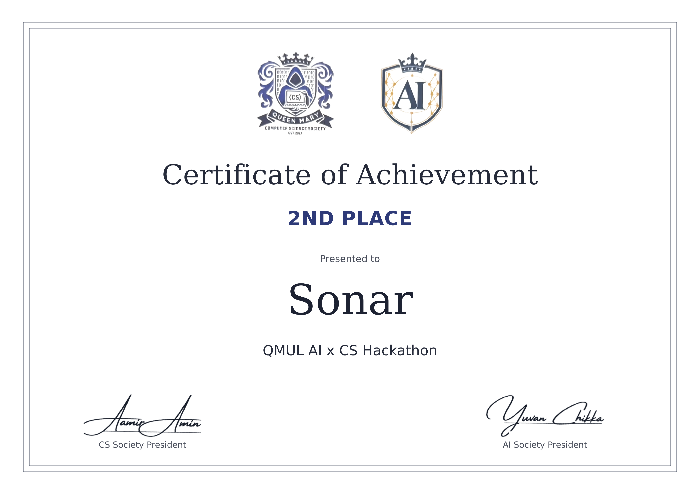

# Sonar Reps

Your phone already has a sonar. Sonar Reps plays near-ultrasonic tones (18.5 to 19.7 kHz) from the iPhone speaker and listens for the echo off your chest. The phase of that echo follows your chest as it moves, so the phone counts push-ups and reads their depth with no camera, no wearable and no special hardware. Built in one day at the QMUL AI x CS Hackathon (theme: Invisible AI), October 2026.

**🥈 2nd place out of about 25 teams.** [Certificate](presentation/certificate.png)

## Why sonar

- **No camera.** Nothing records you, it works in the dark, and there is no framing or lighting to get right.
- **Shaking does not count.** Motion counters are fooled by shaking the phone. Here the phone's motion sensor blocks counting while the phone itself moves. What still gets through is listed under Evaluation.
- **Any phone.** It uses the speaker and microphone every phone already has.

## How it works

```
speaker: 3 tones (18.5, 19.1, 19.7 kHz)  ->  chest  ->  mic
mic -> mix each tone to 0 Hz (I/Q) -> low-pass, null the other tones, 1 kHz
    -> remove the static path (2 Hz high-pass)
    -> phase step per sample from all tones at once (pulse-pair, as in Doppler radar)
    -> path change -> chest movement (lambda/4pi per radian)
    -> rep state machine (depth, return, rest)
```

At 19 kHz the wavelength is 1.8 cm, so one full turn of echo phase is 0.9 cm of chest movement. A push-up is about 25 cm, roughly 28 turns.

## Feasibility, checked

- **Standard phones can do it.** A 2018 study recognised squats and other exercises from the Doppler of a 20 kHz tone on a stock Nexus 5X, with 91% accuracy for squats ([Fu et al., Informatics](https://www.mdpi.com/2227-9709/5/2/24)). It did not count reps or test push-ups.
- **iPhone frequency limit.** iPhone 7 and 8 loopback tests drop sharply above 20 kHz, and their authors used 18.5 kHz ([SonicPACT](https://arxiv.org/pdf/2012.04770)). That is why our tones stay below 20 kHz.
- **Millimetre tracking from phase.** LLAP tracked fingers to millimetres with phone speakers and mics ([LLAP code](https://github.com/Samsonsjarkal/LLAP)).
- **Audibility.** 18.5 kHz is inaudible to most adults, but some young people hear a faint whine. Keep the volume moderate.

## Run it

```sh
pip install numpy scipy sounddevice soundfile matplotlib
python simulate.py                       # synthetic tests, no hardware
python probe_live.py --check             # can this laptop do 19 kHz?
python probe_live.py                     # live tracking on the laptop
python phone_receiver.py                 # live tracking from the iPhone
python analyze_wav.py take.wav --plot take.png
python takes.py                          # replay the real recordings in takes/
python judge.py                          # train the rep judge on the labelled takes, test it on unseen ones
python presentation/make_charts.py       # redraw the charts in presentation/img
```

iPhone: `cd ios && xcodegen generate`, open the project, run on a phone, type the Mac's IP and press Start. The Mac sends its verdict back and the phone shows the count. If the university Wi-Fi blocks the stream, turn on the iPhone's Personal Hotspot and join it from the Mac.

## Status

- Synthetic tests pass: steady, fast (0.7 s) and noisy sets, a shallow rep flagged as no rep, an empty floor counting zero.
- Laptop test on real hardware: all 10 passes of a book over a MacBook Air were detected.
- iPhone 16 Pro Max, face-up on the floor, live to the laptop screen and back to the phone: see Evaluation.
- Today the phone is the speaker and microphone and the laptop does the processing over a local hotspot.
- Every test, including the failed ones, is in `RESULTS.md`.

## Evaluation

Labelled sets recorded on an iPhone 16 Pro Max (10 Oct, 11:22 and 13:19 to 13:27), one person, one room. Each set is judged by the rep judge trained on the other sets only, so it has not seen the set it is judging (`python judge.py`).

| Set | Should count | Counted | |
|---|---|---|---|
| 10 full push-ups (11:22) | 10 | 10 | getting into position refused |
| 10 full push-ups, normal pace | 10 | 10 | |
| 10 full push-ups, fast (0.9 s each) | 10 | 10 | |
| 5 deep push-ups, chest touching down | 5 | 5 | |
| 5 full and 5 half, alternating | 5 | 4 | all 5 half reps refused; 1 full rep refused |
| 10 half reps | 0 | 0 | blocked |
| Phone picked up, slid and shaken | 0 | 0 | blocked; live, the motion sensor also stopped all counting |
| Empty floor, people walking nearby, 30 s | 0 | 1 | one false rep in the first 5 s, none after |
| Hand waved over the phone 10 times | 0 | 8 | **not blocked** |
| 10 kneeling push-ups | 0 | 9 | **not blocked** |

In short: 39 of 40 full push-ups counted, 15 of 15 half reps refused, phone shaking blocked. A hand moved up and down over the phone counts as a rep, and so does a kneeling push-up: the sonar sees one surface moving, not whose it is or where the knees are.

Limits of this table: one person, one phone, one afternoon. Two earlier sets whose true counts were never confirmed read shallower and are not in it.

### The rep judge

`judge.py` finds every down and up, measures it on the way down and on the way back up, and a small trained model (logistic regression, plain numpy, `judge.json`) says full rep or half rep. It judges on two numbers: the larger of the two strokes, and how steadily the echo's phase turned. `phone_receiver.py` uses it by default.

Trained on 55 labelled movements (40 full, 15 half). Tested on sets it had not seen:

| | Full and half reps judged right |
|---|---|
| Rep judge | 54 of 55 |
| One fixed depth line, fitted the same way | 53 of 55 |

Why both strokes: the way down sometimes reads short (one full rep read 8.6 cm down and 16.2 cm back up), and after a pause at the bottom the way up does. The larger of the two is usually right.

What to hold against these figures:

- The two inputs were chosen by scoring feature sets on this same test, so 54 of 55 is somewhat optimistic. The other sets scored 52 to 54.
- A first version with seven inputs and a third verdict, "not a push-up", got 21 of 72: a hand wave gives the same numbers as a push-up, so it cannot be learned from them. Hand waves are tested but not trained on. Telling a hand from a chest needs the distance to the moving surface, which steady tones do not give.
- 55 movements from one person is a small set.

**Depth.** In the deep set the chest went from arms locked (about 30 cm up by Addy's estimate) down to touching, and the sonar read 17.3 to 24.2 cm. So depth is in the right range and probably reads short. It is good enough to sort full from half reps, not to quote in centimetres.

**Volume matters.** With the phone volume turned down the tones were 10 times weaker and a set of 10 read as noise. The receiver now refuses to count and says so, on the laptop and on the phone, when the tones are too quiet.

**The app.** The iPhone screen (SwiftUI, `ios/UI/`) shows the count, a depth column, NO REP, the phone-moved and too-quiet warnings, a result screen with a personal best, and one line of advice after each set. That line is plain rules on the judge's verdicts, not a language model.

## Prior work

Reuses ideas, not code, from my earlier PressPass project (camera push-up counter): the rep state machine design and the replay evaluation approach.

## Video demonstration 

https://www.youtube.com/watch?v=PdGd_M7TYp4&t=13s

## Team

Ximo Gomez, George Guest, Padraig Middleton and Aditya Mitter, at the QMUL AI x CS Hackathon run by the Queen Mary Computer Science Society and QMUL AI Society.


